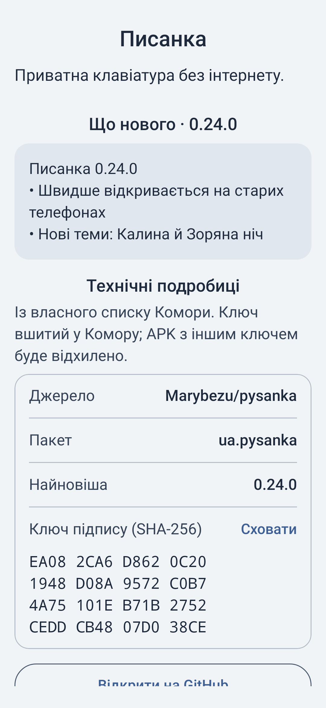

# Комора · Komora

Проста, відкрита й безпечна добірка застосунків для Android. Комора встановлює й оновлює вільні застосунки просто з їхніх репозиторіїв на GitHub. Українською та англійською. Безкоштовно, без реклами, акаунтів і стеження.

<p>




</p>

## Можливості

- **Встановлення й оновлення** застосунків зі списку Комори: «Оновити все» одним дотиком, «Що нового» в кожній версії, знімки екрана, технічні подробиці.
- **Перевірка кожного файлу.** Перелік застосунків і їхні ключі підпису вшиті в саму Комору. Файл встановлюється, лише якщо це саме той застосунок, підписаний закріпленим ключем, і новіший за встановлений. Підмінений на GitHub файл не встановиться.
- **Сповіщення про нові версії** й **автоматичні оновлення** (обидва за замовчуванням вимкнено): приблизно раз на день, через Wi-Fi або будь-який інтернет, за бажанням лише на зарядці. Автоматично оновлюються лише застосунки, які встановила Комора, і лише випусками, яким уже дві доби.
- **Інші джерела** (за замовчуванням вимкнено): після попередження й згоди можна додати будь-який публічний репозиторій GitHub. Комора такі застосунки не перевіряє: перед першим встановленням показує назву, пакет і ключ підпису, далі приймає лише оновлення з тим самим ключем. Додані застосунки — на окремій вкладці з червоною рамкою. Список можна перенести на інший телефон.
- **Видалення** встановленого застосунку просто зі списку (Android перепитує).
- **Вигляд:** кольори телефона або світлі й темні теми з рідними назвами — Крейда, Віск, Небо, Глина, Калина; Поділля, Гуцульщина, Чорнозем, Жар, Зоряна ніч. Для телефонів, планшетів і розкладних.

## Приватність

Акаунтів, аналітики й реклами немає. Комора зʼєднується лише з GitHub і лише через захищене зʼєднання. GitHub бачить адресу телефона, коли Комора питає про нові версії (під час запуску, а у фоні — якщо ввімкнено сповіщення чи автоматичні оновлення), і коли ви відкриваєте подробиці застосунку (тоді завантажуються його знімки екрана, тож GitHub може бачити, який застосунок ви переглядали). Щоб знати, чи встановлено доданий застосунок, Комора бачить застосунки з іконкою на головному екрані, але нікуди їх не надсилає й не зберігає.

## Встановлення

Завантажте `.apk` з [останнього випуску](../../releases/latest) на телефоні й відкрийте його. Браузер чи Android попросять дозволити встановлення з цього джерела. Далі нові версії Комори зʼявляються в її списку: «Оновити» — і готово. Потрібен **Android 12** або новіший.

### Перевірка без Комори

Справжню Комору підписано ключем із таким відбитком SHA-256:

```
282913a584dd2243445552168f79a28385561f3ebbf01edf93a09810d0fd4e27
```

Перевірити завантажений файл (потрібні Android build-tools):

```
apksigner verify --print-certs komora-1.0.0.apk
```

Рядок `Signer #1 certificate SHA-256 digest` має збігатися з відбитком вище. Відбиток не змінюється від версії до версії.

Більше: [PRIVACY.md](PRIVACY.md) — що Комора знає й кому що видно; [SECURITY.md](SECURITY.md) — як повідомити про вразливість.

---

# Komora

A simple, open and safe collection of apps for Android. Komora installs and updates free apps straight from their GitHub repositories. Ukrainian and English. Free, no ads, no accounts, no tracking.

## Features

- **Install and update** the apps in Komora's list: "Update all" in one tap, what's new in every version, screenshots, technical details.
- **Every file is checked.** The app list and each app's signing key are built into Komora. A file is installed only if it is the right app, signed with the pinned key, and newer than the installed one. A file replaced on GitHub will not install.
- **New version notifications** and **automatic updates** (both off by default): about once a day, over Wi-Fi or any connection, optionally only while charging. Only apps Komora installed are updated automatically, and only with releases that have been out for two days.
- **Other sources** (off by default): after a warning and your agreement, any public GitHub repository can be added. Komora does not check those apps: before the first install it shows the app's name, package and signing key, and afterwards accepts only updates with the same key. Added apps have their own tab and a red frame. The list can be moved to another phone.
- **Uninstall** an installed app right from the list (Android asks first).
- **Look:** the phone's own colours, or light and dark themes with Ukrainian names. For phones, tablets and foldables.

## Privacy

No accounts, analytics or ads. Komora connects only to GitHub, only over HTTPS. GitHub sees the phone's address when Komora asks about new versions (at start, and in the background if notifications or automatic updates are on) and when you open an app's details (its screenshots are fetched then, so GitHub can see which app was looked at). To tell whether an added app is installed, Komora can see apps that have a home-screen icon; it never sends or keeps that list.

## Install

Download the `.apk` from the [latest release](../../releases/latest) on your phone and open it. After that, new versions of Komora show up in its own list: tap "Update". Requires **Android 12** or newer.

### Check it without Komora

The real Komora is signed with a key with this SHA-256 fingerprint:

```
282913a584dd2243445552168f79a28385561f3ebbf01edf93a09810d0fd4e27
```

To check a downloaded file (needs Android build-tools):

```
apksigner verify --print-certs komora-1.0.0.apk
```

The line `Signer #1 certificate SHA-256 digest` must match the fingerprint above. It stays the same in every version.

More: [PRIVACY.md](PRIVACY.md) — what Komora knows and who can see what; [SECURITY.md](SECURITY.md) — how to report a vulnerability.

---

## Ліцензія · License

**GPL-3.0-or-later.** Комора — вільне програмне забезпечення: її можна поширювати та змінювати за умовами GNU General Public License, опублікованої Free Software Foundation, версії 3 або (на ваш вибір) будь-якої новішої. Вона поширюється без жодних гарантій. Повний текст: [LICENSE](LICENSE).

Komora is free software: you can redistribute it and/or modify it under the terms of the GNU General Public License as published by the Free Software Foundation, either version 3 of the License, or (at your option) any later version. It comes without any warranty. Full text: [LICENSE](LICENSE).

Код написано за допомогою ШІ (Claude, Anthropic) під керівництвом і з тестуванням автора. · The code was written with AI (Claude, Anthropic), directed and tested by the author.

Бібліотеки та їхні ліцензії · Libraries and their licences: [NOTICE.md](NOTICE.md).

SPDX-License-Identifier: GPL-3.0-or-later
