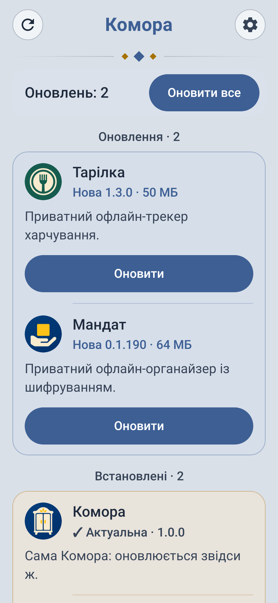
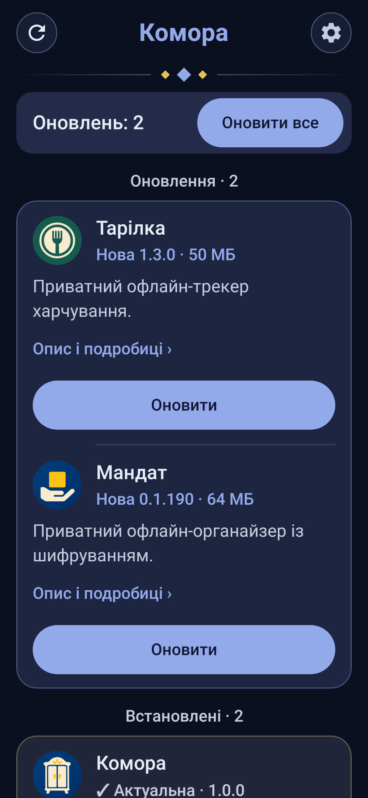
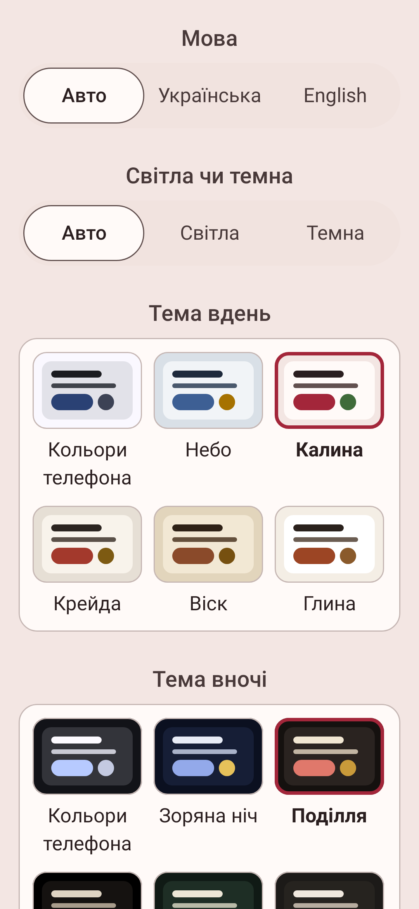

# Комора · Komora

Проста, відкрита й безпечна добірка застосунків для Android. Комора встановлює й оновлює вільні застосунки просто з їхніх репозиторіїв на GitHub. Без реклами, акаунтів і стеження. Українською та англійською.

<p>




</p>

- **Кожен файл перевіряється:** встановлюється лише той застосунок, підписаний ключем, вшитим у Комору.
- **Інші джерела** за бажанням, з попередженням.
- **Світлі й темні теми** з рідними назвами або кольори телефона.

Комора звертається лише до GitHub. Що саме видно GitHub: [PRIVACY.md](PRIVACY.md).

**Встановлення:** завантажте `.apk` з [останнього випуску](../../releases/latest) на телефоні й відкрийте його. Потрібен Android 12 або новіший.

**Перевірка без Комори:** відбиток ключа підпису SHA-256

```
282913a584dd2243445552168f79a28385561f3ebbf01edf93a09810d0fd4e27
```

`apksigner verify --print-certs komora-<версія>.apk`: рядок `Signer #1 certificate SHA-256 digest` має з ним збігатися.

---

A simple, open and safe collection of apps for Android. Komora installs and updates free apps straight from their GitHub repositories. No ads, no accounts, no tracking. Ukrainian and English.

- **Every file is checked:** only the right app, signed with the key built into Komora, is installed.
- **Other sources** if you wish, after a warning.
- **Light and dark themes** with Ukrainian names, or the phone's colours.

Komora connects only to GitHub. What GitHub can see: [PRIVACY.md](PRIVACY.md).

**Install:** download the `.apk` from the [latest release](../../releases/latest) on your phone and open it. Requires Android 12 or newer.

**Check it without Komora:** `apksigner verify --print-certs komora-<version>.apk`; the line `Signer #1 certificate SHA-256 digest` must match the fingerprint above.

---

**GPL-3.0-or-later**, без жодних гарантій · without any warranty: [LICENSE](LICENSE). Бібліотеки · Libraries: [NOTICE.md](NOTICE.md). Вразливості · Security: [SECURITY.md](SECURITY.md).

Код написано за допомогою ШІ (Claude, Anthropic) під керівництвом і з тестуванням авторки. · The code was written with AI (Claude, Anthropic), directed and tested by the author.
